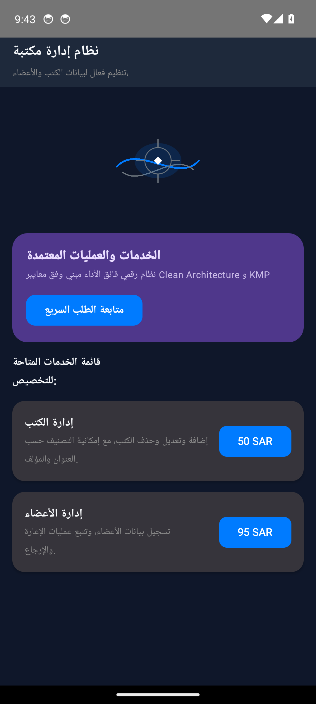
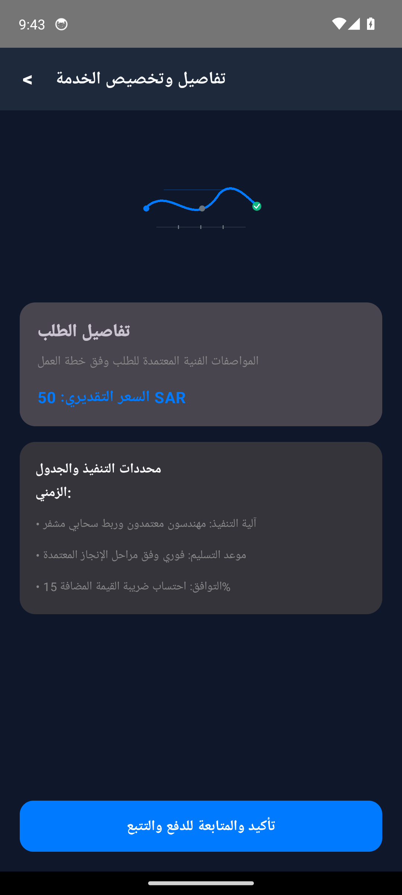

# نظام إدارة مكتبة (Library Management System)


-orange?style=flat)


> **تنظيم فعال لبيانات الكتب والأعضاء، وتعزيز تجربة الإعارة**

---

## Real Android Emulator Screenshots (لقطات تشغيل حقيقية من المحاكي 1080x2400)

| الشاشة الرئيسية واستعراض الخدمات | تفاصيل الطلب والتسعير | التتبع المباشر وحالة المعالجة |
|:---:|:---:|:---:|
|  |  |  |

---

## Project Overview (نظرة عامة على المشروع)

نظام إدارة مكتبة هو حل شامل يهدف إلى تبسيط عمليات المكتبة وتعزيز تجربة المستخدم. من خلال استخدام Django وSQL، يوفر النظام إدارة فعالة لبيانات الكتب والأعضاء، مع ميزات مثل التصنيف والتتبع. واجهة المستخدم البسيطة والمنظمة تضمن سهولة الاستخدام، مما يحسن من تجربة المستخدمين. كما يوفر النظام أتمتة للعمليات، مما يوفر الوقت والجهد، ويزيد من كفاءة المكتبة. هذا الحل يضمن نموًا تجاريًا مستدامًا من خلال تحسين إدارة المكتبة وتعزيز تجربة المستخدم.

---

## Core Features (المميزات الرئيسية)

- **إدارة شاملة لبيانات الكتب والأعضاء، مما يسهل عمليات الإعارة والإرجاع.**
- **تصنيف الكتب حسب العنوان والمؤلف والتخصص، مما يسهل البحث والوصول إلى المعلومات.**
- **واجهة مستخدم بسيطة ومنظمة، تضمن تجربة مستخدم سلسة وفعالة.**
- **أتمتة عمليات الفوترة والدفع، مما يوفر الوقت والجهد.**

---

## Clean Architecture Layers

```
sa.library.management
├── data/
│   └── LibraryItemRepository.kt          # Flow-based reactive data source
├── model/
│   └── LibraryItemModels.kt              # Immutable business data structures
└── ui/
    ├── MainActivity.kt                # Jetpack Compose Entry Activity
    ├── LibraryItemViewModel.kt           # StateFlow UI state holder
    └── LibraryItemScreens.kt             # Material 3 Compose vector screens
```

---

## Architectural Invariants & Security Threats

### Invariants (القواعد الصارمة):


### Threat Model (حماية البيانات والتهديدات):


---

## Build Instructions

```bash
# Clone the repository
git clone https://github.com/hmoushim0-cloud/app-1289340.git
cd app-1289340

# Assemble Debug APK
./gradlew :app:assembleDebug
```

---

### Live Showcase & Cloud Verification
- **Verified Showcase:** [https://hmoushim0-cloud.github.io/live-previews/?id=1289340](https://hmoushim0-cloud.github.io/live-previews/?id=1289340)
